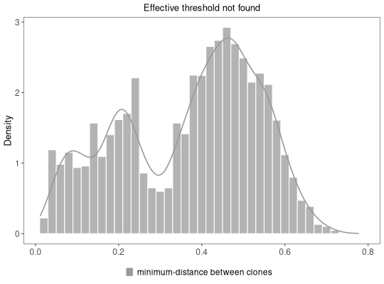

**identicalClones** - *Sequence identity method for clonal partitioning*

Description
--------------------

`identicalClones` provides a simple sequence identity based partitioning
approach for inferring clonal relationships in high-throughput Adaptive Immune Receptor
Repertoire sequencing (AIRR-seq) data. This approach partitions B or T cell receptor
sequences into clonal groups based on junction region sequence identity within
partitions that share the same V gene, J gene, and junction length, allowing for
ambiguous V or J gene annotations.


Usage
--------------------
```
identicalClones(
db,
method = c("nt", "aa"),
junction = "junction",
v_call = "v_call",
j_call = "j_call",
clone = "clone_id",
fields = NULL,
cell_id = NULL,
locus = "locus",
only_heavy = TRUE,
split_light = FALSE,
first = FALSE,
cdr3 = FALSE,
mod3 = FALSE,
max_n = 0,
nproc = 1,
verbose = FALSE,
log = NULL,
summarize_clones = FALSE,
junction_type = c("auto", "nt", "aa"),
sequence = "sequence_alignment"
)
```

Arguments
-------------------

db
:   data.frame containing sequence data.

method
:   one of the `"nt"` for nucleotide based clustering or
`"aa"` for amino acid based clustering.

junction
:   character name of the column containing junction sequences.
Also used to determine sequence length for grouping.

v_call
:   name of the column containing the V-segment allele calls.

j_call
:   name of the column containing the J-segment allele calls.

clone
:   output column name containing the clonal cluster identifiers.

fields
:   character vector of additional columns to use for grouping.
Sequences with disjoint values in the specified fields will be classified
as separate clones.

cell_id
:   name of the column containing cell identifiers or barcodes.
If specified, grouping will be performed in single-cell mode
with the behavior governed by the `locus` and
`only_heavy` arguments. If set to `NULL` then the
bulk sequencing data is assumed.

locus
:   name of the column containing locus information.
Only applicable to single-cell data.
Ignored if `cell_id=NULL`.

only_heavy
:   This is deprecated. Only heavy chains will be used in clustering.
Use only the IGH (BCR) or TRB/TRD (TCR) sequences
for grouping. Only applicable to single-cell data.
Ignored if `cell_id=NULL`.

split_light
:   if `TRUE`, each clone defined from the heavy chains is split
into subgroups of cells whose light chains share V gene, J gene and
junction length (see [groupLightGenes](http://www.rdocumentation.org/packages/alakazam/topics/groupLightGenes)). Clones that are
split get identifiers of the form `"<clone>_G<subgroup>"`.
Requires single-cell data: `cell_id` and `locus` must be set and
the `cell_id` column must exist in `db`, otherwise an error is
raised. See the Single-cell data section for details.

first
:   specifies how to handle multiple V(D)J assignments for initial grouping.
If `TRUE` only the first call of the gene assignments is used.
If `FALSE` the union of ambiguous gene assignments is used to
group all sequences with any overlapping gene calls.

cdr3
:   if `TRUE` removes 3 nucleotides or 1 amino acid residue from both ends
of `"junction"` prior to clustering (converts IMGT junction to CDR3
region). For nucleotide junctions this removes 3 nucleotides from each end
and requires a junction length greater than 6 nucleotides; for amino acid
junctions this removes 1 residue from each end and requires a junction
length greater than 2 residues. Records that are too short are removed.

mod3
:   if `TRUE` removes records with a `junction` length that is not divisible by
3 in nucleotide space. Ignored (with a warning) if the `junction` column
contains amino acid sequences.

max_n
:   The maximum number of non-ATCG characters permitted in the junction nucleotide sequence,
or the maximum number of non-standard amino acid characters permitted in the junction
amino acid sequence, before excluding the record from clonal assignment.
With the default value of 0, nucleotide sequences containing any non-ATCG characters
(including IUPAC codes), or amino acid sequences containing any non-standard amino acid
characters, are removed before clustering. Set to `NULL` to disable filtering.

nproc
:   number of cores to distribute the function over.

verbose
:   if `TRUE` prints out a summary of each step cloning process.
if `FALSE` (default) process cloning silently.

log
:   output path and filename to save the `verbose` log.
The input file directory is used if path is not specified.
The default is `NULL` for no action.

summarize_clones
:   if `TRUE` performs a series of analysis to assess the clonal landscape
and returns a [ScoperClones](ScoperClones-class.md) object. If `FALSE` (default) then
a modified input `db` is returned. In single-cell mode, `vjl_groups`
summarizes heavy/long-chain partitions used for clustering. When grouping by
`fields`, `summarize_clones` should be `FALSE`.

junction_type
:   one of `"auto"` (default), `"nt"`, or `"aa"`. Only used when
`method="aa"` (`"aa"` is an error for other methods). Declares whether the `junction` column holds nucleotide or
amino acid sequences. With `"auto"`, amino acid content is inferred from the presence
of amino-acid-only letters (E, F, I, L, P, Q, ...); short amino acid sequences made only of
letters shared with the nucleotide alphabet (e.g. `"CARDST"`) cannot be told apart
from nucleotides and will be mishandled. Set `"aa"` or `"nt"` to skip autodetection.

sequence
:   Character name of the column containing sequence alignments. This will be used in single-cell mode
with split_light=TRUE to assign cells without light chains to a light chain group.


Value
-------------------

If `summarize_clones=FALSE` (default) a modified `data.frame` is returned with clone identifiers in the
specified `clone` column.
If `summarize_clones=TRUE` a [ScoperClones](ScoperClones-class.md) object is returned that includes the
clonal assignment summary information and a modified input `db` in the `db` slot that
contains clonal identifiers in the specified `clone` column.


Single-cell data
-------------------


To invoke single-cell mode the `cell_id` argument must be specified and the `locus`
column must be correct. Otherwise, clustering will be performed with bulk sequencing assumptions,
using all input sequences regardless of the values in the `locus` column.

Values in the `locus` column must be one of `c("IGH", "IGI", "IGK", "IGL")` for BCR
or `c("TRA", "TRB", "TRD", "TRG")` for TCR sequences. Otherwise, the operation will exit and
return an error message.

In single-cell mode, clonal clustering is performed using heavy/long chains only
(IGH for BCR or TRB/TRD for TCR). The `only_heavy=FALSE` is deprecated
and ignored with warnings.
Consequently, `vjl_groups` summarizes heavy/long-chain V/J/junction-length
partitions and does not define groups from light/short chains.

With `split_light=TRUE`, each heavy/long-chain clone is then split by light/short chain
V gene, J gene and junction length using [groupLightGenes](http://www.rdocumentation.org/packages/alakazam/topics/groupLightGenes). Cells without a
light/short chain are assigned to the subgroup of the most similar heavy/long chain, using the
sequences in the `sequence` column. Light/short chains take the clone identifier of the
heavy/long chain in the same cell. The split is done before the clonal summary, so with
`summarize_clones=TRUE` the summary describes the split clones. If `db` contains no
light/short chains, `split_light=TRUE` has no effect and a warning is raised.

In single-cell mode, clonal clustering will not be performed on data where cells are
assigned multiple heavy/long chain sequences (IGH, TRB, TRD). If observed, the operation
will exit and return an error message. Cells that lack a heavy/long chain sequence (i.e., cells with
light/short chains only) will be assigned a `clone_id` of `NA`.


Examples
-------------------

```R
# Find clonal groups
results <- identicalClones(ExampleDb, summarize_clones = TRUE)

```

*Running defineClonesScoper in bulk mode and only keep heavy chains*
```R

# Retrieve modified input data with clonal clustering identifiers
df <- as.data.frame(results)

# Plot clonal summaries
plot(results, binwidth = 0.02)

```




See also
-------------------

See [plotCloneSummary](plotCloneSummary.md) for plotting summary results. See [groupGenes](http://www.rdocumentation.org/packages/alakazam/topics/groupGenes) for
more details about grouping requirements.


